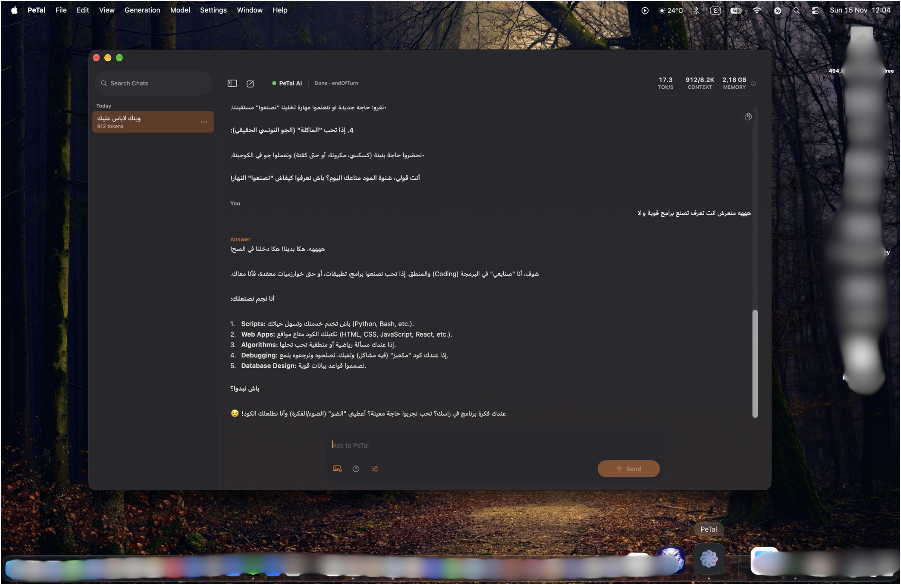

<h1 align="center">PeTal</h1>

 

  

## Fix after copying to another Mac

If you copy `PeTal` to another Mac, PeTal may show `directory mismatch`.

Fix `verified-install.json` in each model folder:

1. Open `gemma4.gturbo / verified-install.json`
2. Change `modelDirectoryPath` to your new location, example:
   `/Users/YOUR_USERNAME/Desktop/PeTal/gemma4.gturbo`
3. Do the same for `gemma4.vision.gturbo / verified-install.json`:
   `/Users/YOUR_USERNAME/Desktop/PeTal/gemma4.vision.gturbo`
4. Save, reopen PeTal, click `Use Existing Model...` and `Check Again`

Note: The path must match exactly where the folder is on your Mac. If your username is different, change it too.
----------------------------------------------------------------------------------------------------------------

## Fix after copying to another Mac

If you copy `PeTal` to another Mac, PeTal may show `directory mismatch`.

Fix `verified-install.json` in each model folder:

1. Open `gemma4.gturbo / verified-install.json`
2. Change `modelDirectoryPath` to your new location, example:
   `/Users/YOUR_USERNAME/Desktop/PeTal/gemma4.gturbo`
3. Do the same for `gemma4.vision.gturbo / verified-install.json`:
   `/Users/YOUR_USERNAME/Desktop/PeTal/gemma4.vision.gturbo`
4. Save, reopen PeTal, click `Use Existing Model...` and `Check Again`

Note: The path must match exactly where the folder is on your Mac. If your username is different, change it too.
----------------------------------------------------------------------------------------------------------------

  <b>شات AI على ماك، يخدم بلا انترنت، بلا ما تختار الموديل!</b> 
  انت على اليمين، PeTal على اليسار !

  <a href="https://huggingface.co/KAPTENHD/PeTal-full">⬇️ حمل PeTal الكامل - المجلد كلو</a>

## 📸 الواجهة

  

## ✨ What's inside?
- 🔒 Your chats stay on your Mac!

## 📩 How to install?
1. Download the full folder from the link above!
2. Open the folder!
3. Open PeTal.app and it works! 🚀

## ⚠️ Why is the model not on 【entity-GitHub¦canonical_name=GitHub】?
- Model 14.1G = Vision 1.1G + 13G!
- 【entity-GitHub¦canonical_name=GitHub】 doesn't accept this size!
- So the full folder downloads from the link above, and 【entity-GitHub¦canonical_name=GitHub】 is just showcase!

PeTal 🌸 - Made with love in Tunisia

## ✨ C'est quoi?
- 🔒 Tes chats restent sur ton Mac!

## 📩 Comment installer?
1. Télécharge tout le dossier depuis le lien ci-dessus!
2. Ouvre le dossier!
3. Ouvre PeTal.app et ça marche! 🚀

## ⚠️ Pourquoi le modèle n'est pas sur GitHub?
- Modèle 14.1G = Vision 1.1G + 13G!
- GitHub n'accepte pas cette taille!
- Donc tout le dossier se télécharge depuis le lien ci-dessus, et GitHub c'est juste la vitrine!

PeTal 🌸 - Fait avec amour en Tunisie

## ✨ 안에 뭐가 있어요?
- 🔒 채팅은 Mac에 남아요!

## 📩 어떻게 설치해요?
1. 위 링크에서 전체 폴더를 다운로드!
2. 폴더를 열어!
3. PeTal.app을 열면 바로 작동! 🚀

## ⚠️ 왜 모델이 GitHub에 없어요?
- 모델 14.1G = Vision 1.1G + 13G!
- GitHub은 이 크기를 받아주지 않아요!
- 그래서 전체 폴더는 위 링크에서 다운로드하고, GitHub은 쇼케이스예요!

PeTal 🌸 - 튀니지에서 사랑으로 만들었어요

## ✨ شنو فيه؟

- 🔒 محادثاتك تبقى في ماك متاعك، 

## 📥 كيفاش تصبو؟

### 1. حمل المجلد الكلو من الرابط اللي فوق!
### 2. حل المجلد!
### 3. حل PeTal.app و يخدم طول! 🚀

## ⚠️ علاش الموديل مش في GitHub؟

- الموديل `13G` + `Vision 1.1G` = `14.1G`!
- GitHub ما يقبلش الحجم هاذا!
- على هاكا المجلد الكلو يتحمل من رابط التحميل اللي فوق، و GitHub كان اشهار!

---
PeTal 🌸 - مصنوع بحب في تونس

---
⚠️ تخدم كان على Mac! لازم Mac RAM 8GB على الأقل!
⚠️ يعمل فقط على Mac! يجب أن يكون Mac بذاكرة 8GB على الأقل!
⚠️ Mac only! Requires at least 8GB RAM Mac!
⚠️ Mac 전용! 최소 8GB RAM Mac 필요!

🤗 [Open PeTal on HuggingFace](https://huggingface.co/KAPTENHD/PeTal-full)
